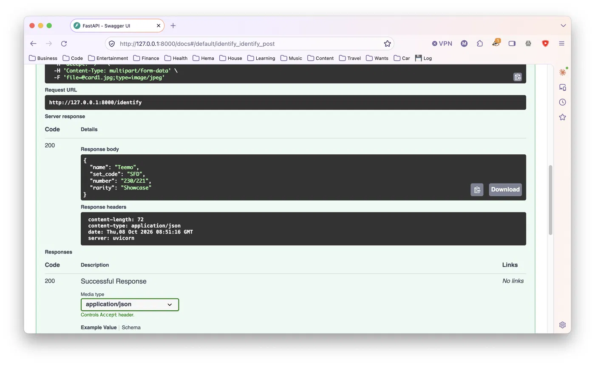

**Card Scout**

An AI agent that identifies Riftbound trading cards from photos built to support my Riftbound TCG trading/collecting (in progress).

To run it:

```bash
python3 -m venv venv
source venv/bin/activate
pip install -r requirements.txt
uvicorn main:app --reload
```

Then open http://127.0.0.1:8000/health

Next:

- Identify a card from a photo


## Results

Eval: 10 photos of my own Riftbound cards, scored by exact match against hand-written labels (`labels.csv`).

| Run | Change | Full match | Name | Set code | Number | Rarity |
|-----|--------|-----------|------|----------|--------|--------|
| 1 | Baseline prompt | 3/10 | 4/10 | 10/10 | 10/10 | 7/10 |
| 2 | Prompt asks for the full card name, including the subtitle | 8/10 | 10/10 | 10/10 | 10/10 | 8/10 |
| 3 | Prompt adds granular level guidance for identifying rarity | 10/10 | 10/10 | 10/10 | 10/10 | 10/10 |

Each row is a single run, and model output varies slightly between runs. The prompt was tuned on these same 10 cards, so these scores are on the tuning set. A held-out set is planned.

- Look up prices from legitimate APIs
- Measure identification accuracy on photos of my own cards